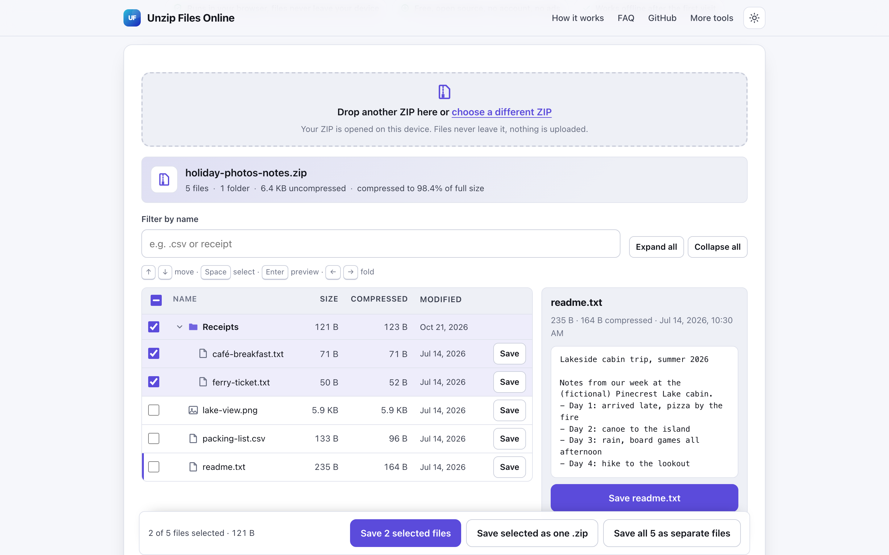
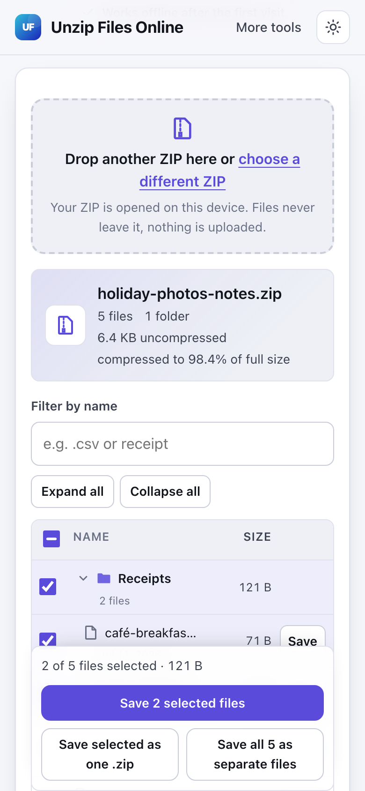

# Unzip Files Online

> Open a ZIP in your browser, browse its files, and save one or all of them, with nothing uploaded.

**🌐 Use it now: [turhe123.github.io/unzip-files-local](https://turhe123.github.io/unzip-files-local/)** · free · open source · runs in your browser · works offline


## Why

Unzip Files Online is a free, open-source alternative to tools like ezyZip Unzip, which upload your archive or process it through an ad-supported page, ask you to sign up for big archives, and can be cluttered with ads and lookalike download buttons on mobile. Here your files never leave the device, there is no account, no ads and no limits, it works offline, and it can be installed as an app. That matters on Chromebooks, locked-down work laptops, phones and tablets where no archive tool is installed, and for archives you would rather not send to a stranger's server.

## Screenshots

<p align="center"></p>

<p align="center"><em>Unzip Files Online in the browser, light theme</em></p>

<p align="center"></p>

<p align="center"><em>Unzip Files Online on a phone</em></p>

## Features

- Drop a ZIP on the page or pick one with the file chooser; the keyboard works too.
- Reads only the central directory at the end of the file to list entries, so nothing is decompressed until you ask for it.
- File tree with collapsible folders, empty folders shown, and Expand all / Collapse all. Small archives open fully expanded.
- Columns for name, size, compressed size and modified date.
- Archive summary: file count, folder count, total uncompressed size and compression ratio.
- Filter the list by file name.
- Preview in a side panel on wide screens, below the list on narrow screens:
  - text files show the first 4 KB;
  - images (PNG, JPEG, GIF, WebP, BMP, ICO, AVIF, SVG) are shown up to 25 MB;
  - other files get a note instead of a broken preview.
- Per-entry **Save** buttons that download the file with its original name.
- Checkboxes (also on folders) with **Save selected**, **Save selected as one .zip** (repacked in the browser) and **Save all as separate files**. Several downloads are staggered so browsers accept them, and clashing names are numbered.
- Every extracted file is checked against its stored CRC-32; a mismatch is reported as a damaged archive.
- Nested ZIPs can be opened by clicking them, with a "Back to" link to the parent archive.
- Keyboard navigation: arrow keys move through the list, Space toggles the checkbox, Enter opens the preview or folds a folder, Left/Right fold folders.
- File names: UTF-8 when flagged or valid, otherwise CP437 (fixes garbled names from older Windows archives); Info-ZIP Unicode paths are honoured.
- Paths with `..`, drive letters or leading slashes are cleaned so saved names cannot point outside the downloads folder.
- Large entries (over 4 MB) are decompressed in a Web Worker with a progress bar.
- Clear, visible messages for: not a ZIP file, corrupt or incomplete archive, unsupported compression, password-protected entries, split archives, executables and files too large for a browser tab.
- Warnings for a possible zip bomb and for very large archives on phones.
- Light and dark themes; layout works at 390 px wide.

**Input:** `.zip` archives, including ZIP64, with Stored and Deflate entries.

**Output:** individual files, or a new `.zip` of the selected files.

**Limits:**

- Not supported: password-protected (encrypted) entries, other compression methods (for example LZMA, bzip2, Deflate64, Zstandard), split/multi-part archives, self-extracting `.exe` files, and other formats such as RAR, 7z or tar. Such entries are still listed and clearly marked.
- A single entry larger than about 2 GB cannot be extracted in a browser tab.
- Archives over 1 GB may run out of memory on phones, especially Safari on iOS.
- A warning appears when the total uncompressed size exceeds 4 GB (or the ratio is extreme on a large archive).
- At most 3,000 rows are shown at once; use the filter to find the rest.

## How to use

1. Open the page and drop a ZIP file on the drop zone, or click it to choose one.
2. Browse the file tree, use the filter to find a name, and click a file (or press Enter on it) to preview it.
3. Click **Save** next to a file to download it, or tick several files or folders.
4. Use **Save selected**, **Save selected as one .zip**, or **Save all as separate files** in the bar below the list.

## Privacy

- Nothing is uploaded. The archive is read with the browser's File API and extracted on your device.
- No cookies, no accounts, no ads.
- Page views are counted anonymously with [GoatCounter](https://www.goatcounter.com/) (cookieless, open source). It never sees your files or their names.
- After the first visit the page works offline thanks to a service worker.

## Run it locally

No build step.

```sh
git clone https://github.com/turhe123/unzip-files-local
cd unzip-files-local
python3 -m http.server 4173
```

Then open http://127.0.0.1:4173/.

## Tests

```sh
npm i -D @playwright/test && npx playwright install chromium
npx playwright test
```

## Third-party code

- [fflate](https://github.com/101arrowz/fflate) 0.8.2, MIT license (`vendor/fflate/`).

## Built with AI

Unzip Files Online was written by [Claude Code](https://claude.com/claude-code) inside an automated pipeline, from a plain-English spec. No code or assets from any commercial product were used; it is a clean-room implementation of a feature set, not a copy.

What that means in practice:

- The full source is in this repo under the MIT license. Read it before you trust it with your files.
- Everything runs in your browser. It makes no network requests except an anonymous, cookieless page-view count (GoatCounter); your files never leave the device.
- The page is tested headless in Chromium (Playwright) before every release, but it has had less human review than hand-written software. Bug reports and pull requests are welcome.

## Support ❤️

If this saved you a download-button hunt, you can support the project on [Ko-fi](https://ko-fi.com/leodavidai).

## More free web tools

See more free, private tools at [turhe123.github.io/web-tools](https://turhe123.github.io/web-tools/).

## License

MIT © Or Davidai Bachar
